# Gabriel Arezi

📍 Cariacica, ES · Brasil · 🌐 Atendimento remoto para todo o país

---

## 💼 Desenvolvedor Full Stack autônomo

Atuo como **freelancer** desenvolvendo sistemas web completos: do banco de dados à interface, passando pela API e pelo deploy. Se sua empresa tem uma ideia, um processo manual ou um sistema que precisa evoluir, posso desenvolver a solução.

- 🧭 **Do levantamento ao deploy:** entendo o problema do negócio, proponho a arquitetura e entrego o projeto funcionando
- 🧩 **Código organizado e documentado**, pensado para que sua equipe consiga dar continuidade
- 🔄 **Comunicação direta**, sem intermediários, com atualizações durante todo o projeto
- 📈 **Sempre atualizado** com as tecnologias mais usadas no mercado

---

## 🤝 Como posso ajudar sua empresa

| Serviço | O que entrego |
|---|---|
| 🌐 **Sistemas web sob medida** | Painéis administrativos, sistemas de gestão, plataformas internas e portais |
| 🔌 **APIs e back-end** | APIs REST e GraphQL com Spring Boot, Node.js, NestJS ou PHP |
| 🎨 **Front-end moderno** | Interfaces responsivas e rápidas com React e Next.js |
| 🗄️ **Banco de dados** | Modelagem, consultas e otimização em MySQL e PostgreSQL |
| ⚙️ **Automação e integrações** | Fluxos com n8n e Zapier, integração entre sistemas e APIs de terceiros |
| 🚀 **Deploy e infraestrutura** | Containers com Docker, pipelines de CI/CD e hospedagem em AWS ou Azure |
| 🛠️ **Manutenção e evolução** | Melhorias, correções e novas funcionalidades em sistemas já existentes |

> 💬 **Tem um projeto em mente?** Me chama no [LinkedIn](https://www.linkedin.com/in/gabriel-arezi) ou no Discord (xGsa) e me conta o que você precisa. Respondo com uma proposta inicial.

---

## 🗂️ Projetos em destaque

| Projeto | Descrição |
|---|---|
| 🚚 **[Brasil Logística](https://github.com/g-arezi/brasil-logistica)** | Plataforma que conecta empresas, transportadoras, agenciadores e motoristas de todo o Brasil para negociação e gestão de fretes. |
| 🛡️ **EngenhaRiov3** | Sistema de gestão de projetos, em evolução da versão 2, com a estrutura reescrita em PHP. |
| 🎫 **[HelpDeskv4](https://github.com/g-arezi/HelpDeskv4)** | Sistema de suporte técnico em PHP puro com arquitetura MVC, armazenamento em JSON, chat, tema claro/escuro e layout responsivo para celular. |

Mais trabalhos no meu **[portfólio](https://gabriel-arezi.vercel.app/)**.

---

## 🛠️ Stack principal

**Linguagens**

**Frameworks e ferramentas**

---

## 🎓 Formação e trajetória

- 🎓 Estudante de **Análise e Desenvolvimento de Sistemas** na Estácio (2025–2027)
- 💼 Freelancer em desenvolvimento web desde 2022, com projetos para clientes e projetos próprios
- 🌱 Sempre aprendendo algo novo e explorando novas tecnologias

---

## 👾 Contribuições em modo arcade

<picture>
  <source media="(prefers-color-scheme: dark)" srcset="https://raw.githubusercontent.com/g-arezi/g-arezi/output/pacman-contribution-graph-dark.svg">
  <source media="(prefers-color-scheme: light)" srcset="https://raw.githubusercontent.com/g-arezi/g-arezi/output/pacman-contribution-graph.svg">
  
</picture>

---

## ⚙️ GitHub Stats

---

> *"Transformando ideias em software que funciona."*

**⭐ Se curtir, deixe uma estrela nos repositórios e compartilhe!**

